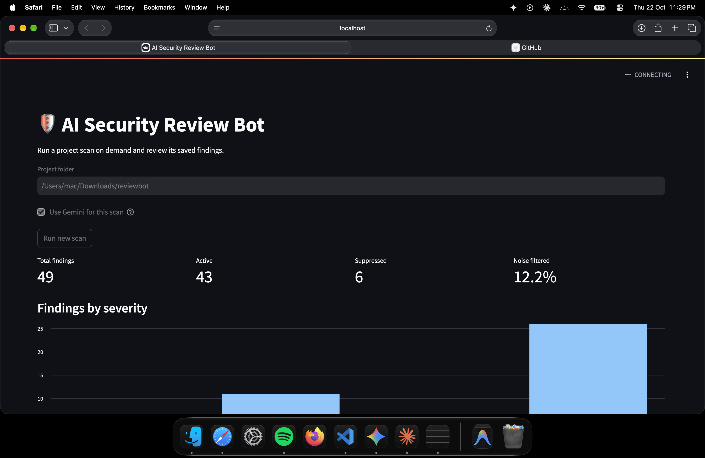
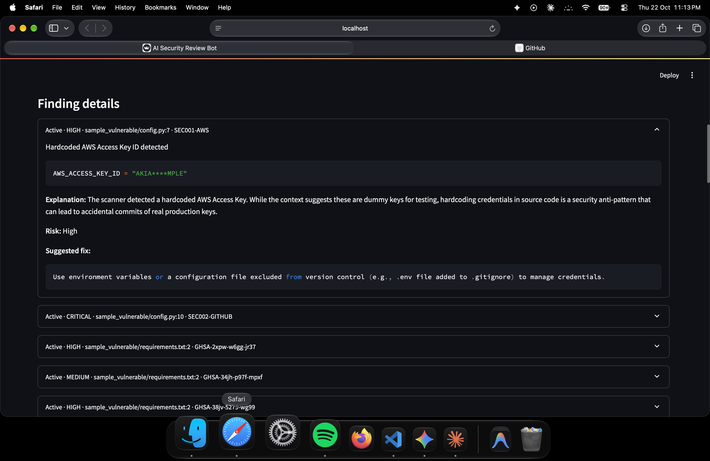
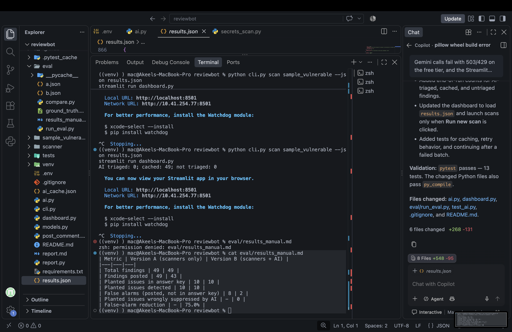

# 🛡️ AI Security Review Bot for GitHub Pull Requests

An intelligent, automated CI/CD security bot that scans Pull Request code changes for vulnerabilities, uses Google Gemini to explain each issue in beginner-friendly language, filters out likely false alarms, and posts actionable reviews directly to GitHub PR comments.

## Setup
Use Python 3.12 for the pinned dependencies in `requirements.txt`.

```bash
cd reviewbot
python3.12 -m venv --clear venv
source venv/bin/activate
python -m pip install -r requirements.txt
streamlit run dashboard.py
```

Enter the folder you want to scan in the dashboard and select **Run new scan**.
The dashboard reads findings from `results.json` and only starts a CLI scan after
you select that button.
Dependency vulnerability checks use the OSV API and require internet access.
Gemini explanations are optional and require `GEMINI_API_KEY` in the environment
or a local `.env` file. For a command-line scan, run
`python cli.py scan /path/to/project --no-ai`.

AI triage sends at most 15 findings by severity by default. Configure
`AI_MAX_FINDINGS` to change the limit and `AI_DELAY_SECONDS` to change the
12-second pause between AI batches. AI verdicts are cached in the ignored local
file `ai_cache.json` and reused by both normal scans and the evaluation script.

## Results

We tested the bot on the sample_vulnerable project, which has 10 planted problems. Scanners only: 49 findings, 10/10 planted issues found, 8 false alarms. Scanners + AI: 43 posted, 10/10 found, 2 false alarms, none of the planted problems suppressed (75% false-alarm reduction). The test project is small, so the numbers are only indicative.






