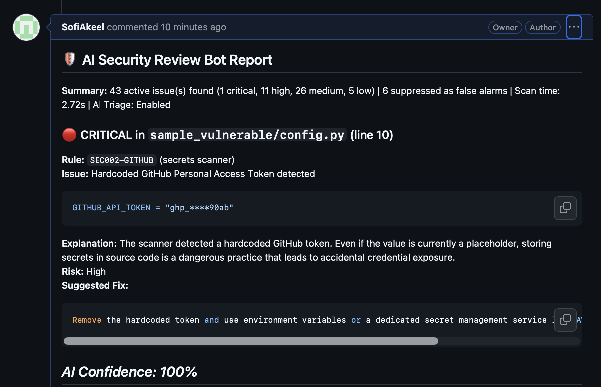

# 🐤 Canary

### Smart Code Security & Pull Request Review Bot

**Canary** is an automated code security scanner and GitHub Pull Request review tool built with **Python**, **Streamlit**, and the **Google Gemini API**.

It scans Python projects for security vulnerabilities, uses AI to filter out false alarms, explains each security issue in simple beginner-friendly language, and posts formatted review reports directly to GitHub Pull Requests.

---

## 📌 Problem Statement

* **Manual Code Review takes time:** Developers often miss hardcoded API keys, exposed tokens, or unsafe functions when reviewing code manually.
* **Too many false alarms in basic scanners:** Traditional rule-based scanners flag every suspicious word (including safe test files and dummy examples), which wastes developer time.
* **Hard-to-understand warnings:** Standard security tools only show error codes without explaining *why* the code is risky or *how* to fix it.

---

## 🎯 Project Objectives

1. **Detect Vulnerabilities Automatically:** Scan source code and `requirements.txt` for hardcoded secrets, unsafe code patterns, and vulnerable third-party libraries.
2. **Reduce False Alarms with AI:** Use the Google Gemini API (`gemini-3.1-flash-lite`) to read the code context and suppress false alarms.
3. **Provide Simple Fixes:** Generate clear explanations, risk ratings, and suggested code fixes for every real issue.
4. **Visual Dashboard & GitHub Integration:** Display results in an interactive **Streamlit Web Dashboard** and publish the report to **GitHub Pull Requests**.

---

## ⚙️ How It Works (System Architecture)

1. **Code & Dependency Scanner (`scanner/`):** Scans project files using pattern rules to detect hardcoded secrets (such as API keys and GitHub tokens), risky Python functions, and known dependency issues via the OSV API.
2. **AI Triage Engine (`ai.py`):** Sends the detected findings to **Google Gemini**. The AI checks whether the finding is a real vulnerability or a safe false alarm, assigns a confidence score, and writes a beginner-friendly explanation and fix.
3. **Local Caching (`ai_cache.json`):** Saves AI responses locally in a JSON file so repeated scans run fast without wasting API calls.
4. **Reporting & Visualization (`dashboard.py` & `post_comment.py`):**
   * Saves scan results to `results.json` and generates a clean Markdown summary in `report.md`.
   * Displays interactive charts and finding cards in the **Streamlit Dashboard**.
   * Posts the Markdown report directly as a comment on the **GitHub Pull Request** using the GitHub REST API.

---

## 🛠️ Tech Stack

* **Language:** Python 3.12
* **Web Dashboard:** Streamlit
* **AI Integration:** Google Gemini API (`gemini-3.1-flash-lite`)
* **GitHub Integration:** GitHub REST API (`requests` library)
* **Data Storage:** JSON (`results.json`, `ai_cache.json`) & Markdown (`report.md`)

---

## 📂 Project Files

```text
reviewbot/
├── docs/images/           # Project result screenshots
├── eval/                  # Scripts used to compare Scanner vs. AI accuracy
├── sample_vulnerable/     # Sample project with 10 planted issues for testing
├── scanner/               # Rules for scanning secrets, code, and dependencies
├── ai.py                  # Connects to Google Gemini API for explanations & triage
├── cli.py                 # Command-line script to start a scan
├── dashboard.py           # Streamlit web dashboard interface
├── models.py              # Data models for storing scan findings
├── post_comment.py        # Publishes report.md to a GitHub Pull Request
├── report.py              # Converts scan results into a Markdown report
└── requirements.txt       # Required Python libraries
```

---

## 🚀 Setup & How to Run

### 1. Install Dependencies
Use Python 3.12 to create the virtual environment and install the required packages:

```bash
cd reviewbot
python3.12 -m venv --clear venv
source venv/bin/activate
python -m pip install -r requirements.txt
```

### 2. Set Environment Variables
Add your API keys in the `.env` file and load them into the terminal:

```bash
export $(grep -v '^#' .env | xargs)
```

### 3. Run the Streamlit Dashboard
```bash
streamlit run dashboard.py
```
Enter the folder you want to scan (e.g., `sample_vulnerable`) in the dashboard and select **Run new scan**. The dashboard reads findings from `results.json` and runs a scan when you click the button.

### 4. Run from the Terminal (CLI)
```bash
# Scan with Gemini AI explanations enabled
python cli.py scan sample_vulnerable

# Scan using static rules only (without AI)
python cli.py scan sample_vulnerable --no-ai
```

---

## 📊 Results

We tested **Canary** on the `sample_vulnerable` project, which has **10 planted security problems**:

* **Scanners Only (Without AI):** 49 findings | 10/10 planted issues found | 8 false alarms.
* **Scanners + Gemini AI:** 43 findings posted | 10/10 planted issues found | 2 false alarms | **0 real issues missed (75% false-alarm reduction)**.

### Dashboard Summary


### Example Finding with AI Explanation


### Evaluation Table


### GitHub Pull Request Comment


